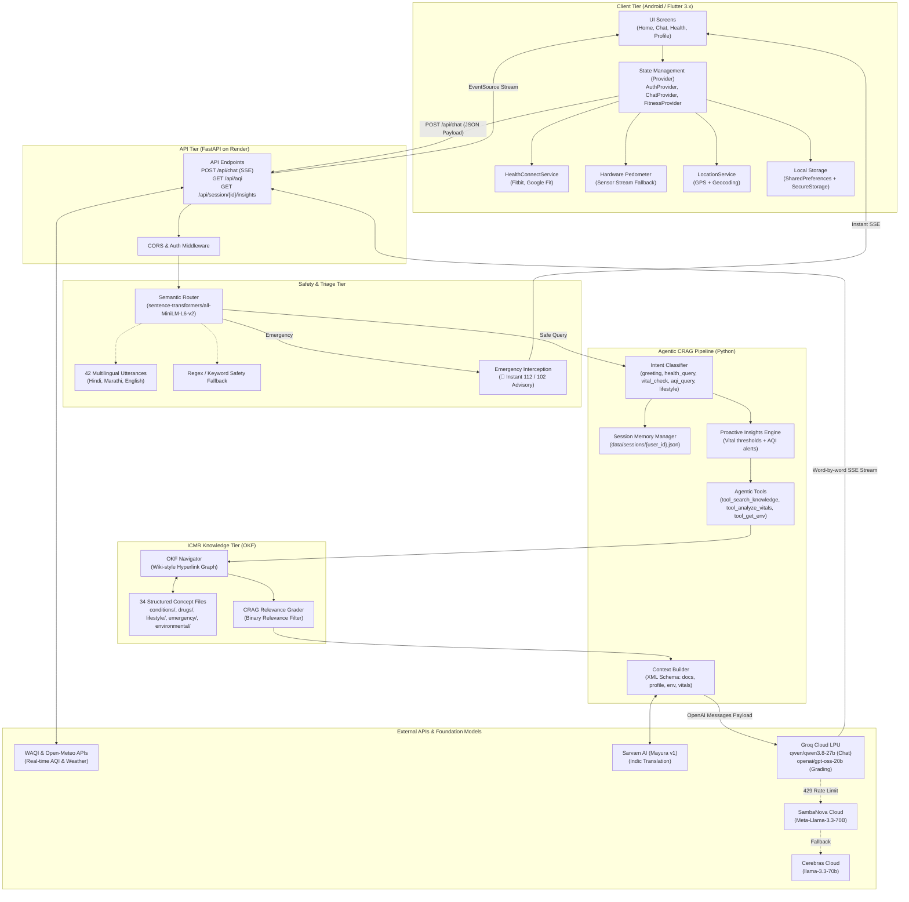
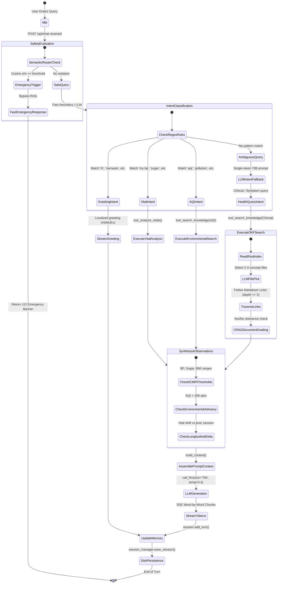
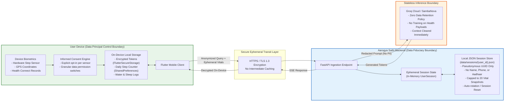
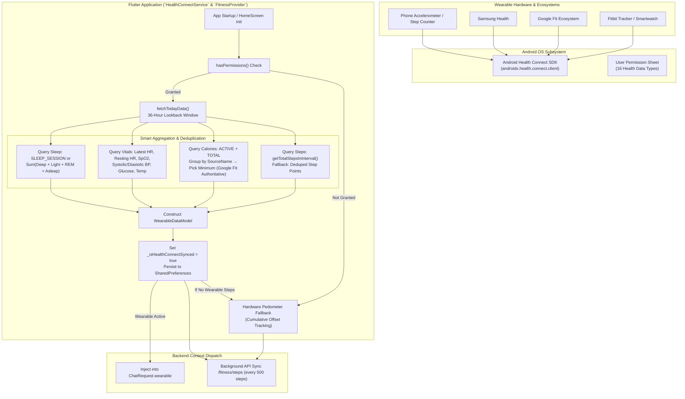
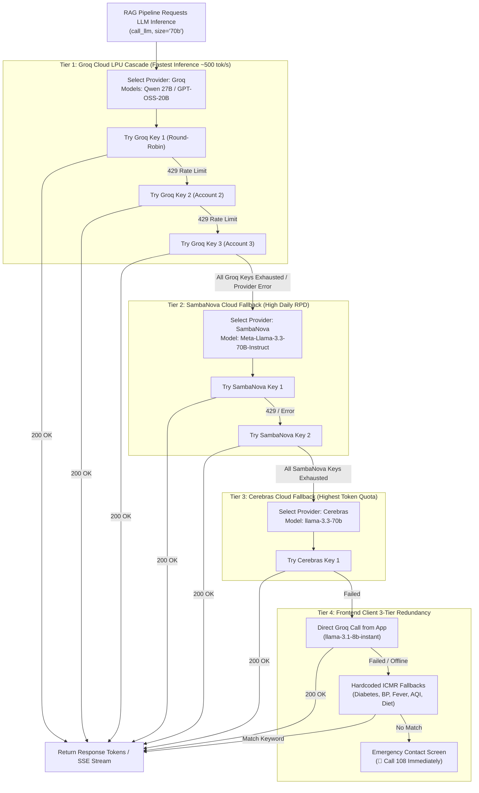
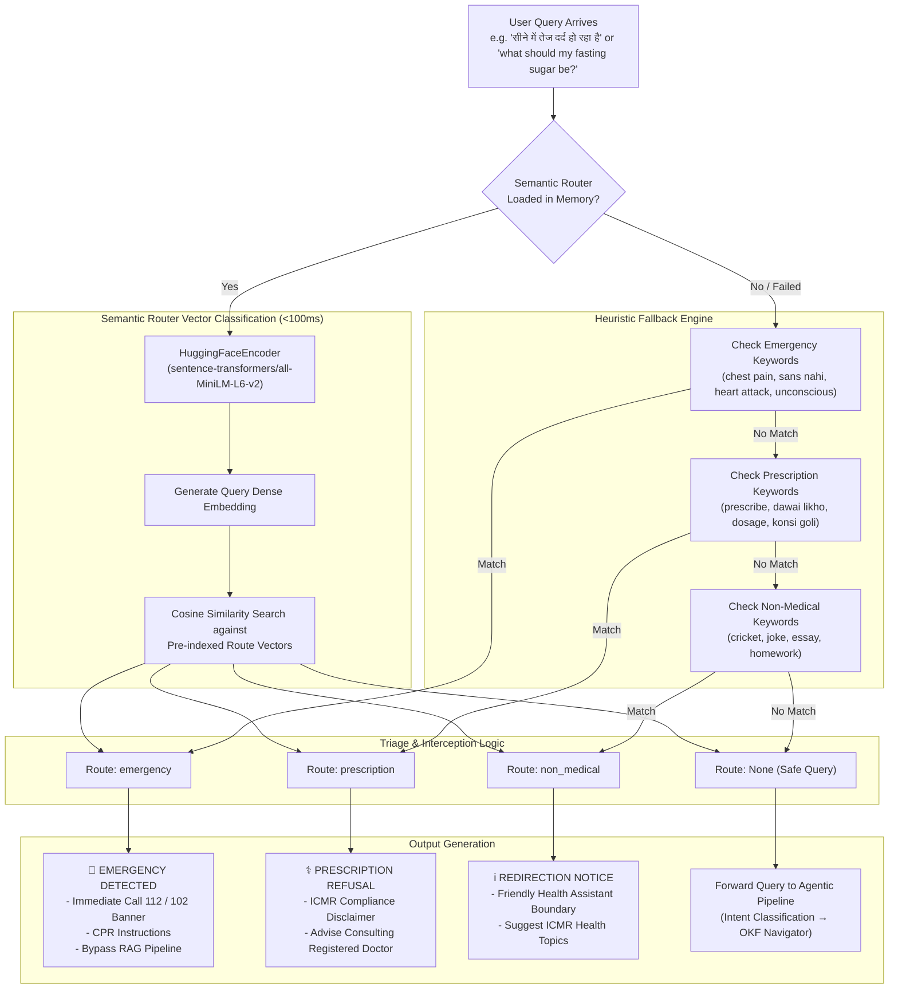
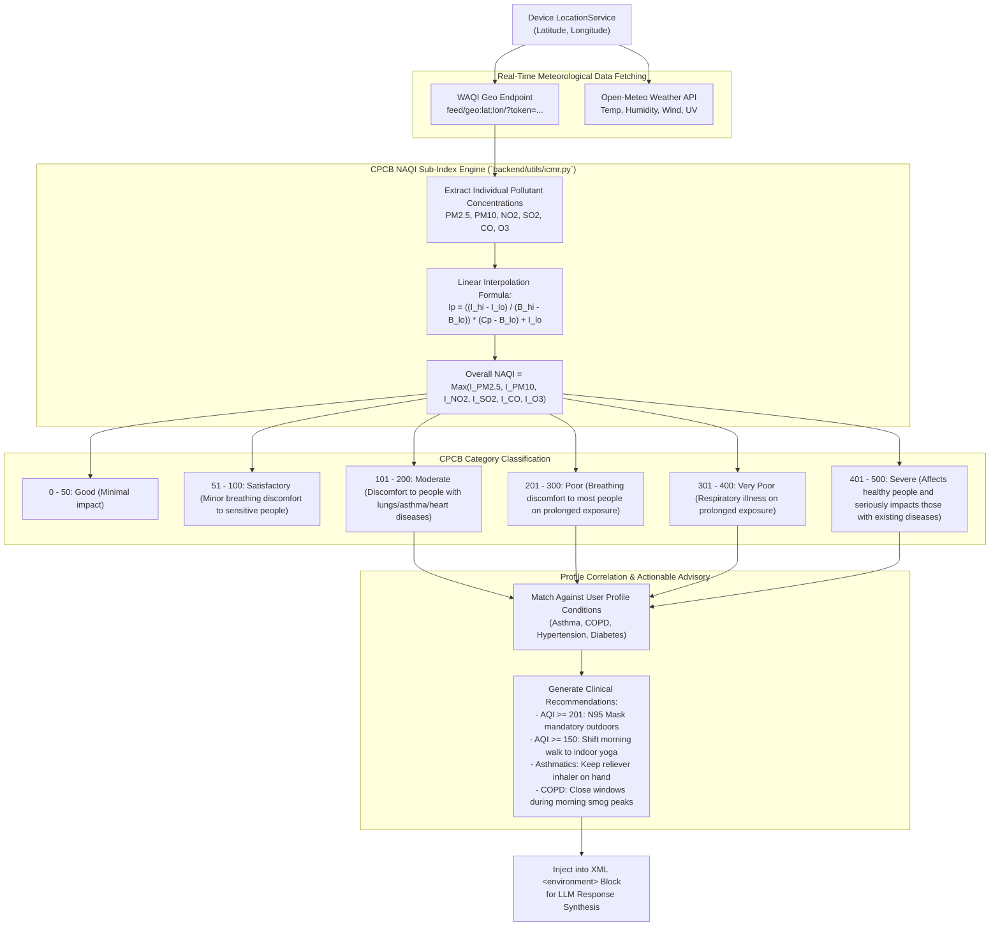

# Aarogya Sathi — System Architecture Diagrams

This document contains the complete set of 7 capstone architecture diagrams for the **Aarogya Sathi** platform. Each diagram is rendered in standard Mermaid syntax and accurately reflects the production implementation across `frontend/`, `backend/`, and `icmr-knowledge-bundle/`.

---

## Diagram 1: Overall System Architecture

High-level architecture showing the Flutter client, FastAPI backend on Render, RAG components, knowledge retrieval, and LLM inference cascade.

---

## Diagram 2: Agentic ReAct Loop State Machine

Represents the state transitions during a single turn of the `CRAGPipeline.run()` execution flow.

---

## Diagram 3: DPDP Act 2023 Compliance & Privacy Boundary

Illustrates the zero-storage session architecture, on-device data sovereignty, and compliance boundaries under the Digital Personal Data Protection Act (DPDP Act, 2023).

---

## Diagram 4: Wearable & Sensor Synchronization Pipeline

Details how wearable metrics from Fitbit, Google Fit, and Samsung Health flow through Android Health Connect into the Flutter app, featuring smart deduplication and pedometer fallback.

---

## Diagram 5: Multi-Key Pooling & Multi-Provider Failover Waterfall

Depicts how the system guarantees 100% uptime during demonstrations and evaluations by cascading across multiple free-tier LLM accounts and providers.

---

## Diagram 6: Safety Router & Clinical Triage Pipeline

Illustrates sub-100ms query classification using Semantic Router and MiniLM sentence embeddings, separating critical emergencies from clinical questions.

---

## Diagram 7: Environmental NAQI Calculation & Clinical Alerting Pipeline

Shows how GPS coordinates are converted into real-time National Air Quality Index (NAQI) values, evaluated against CPCB breakpoints, and converted into clinical preventive advice.

