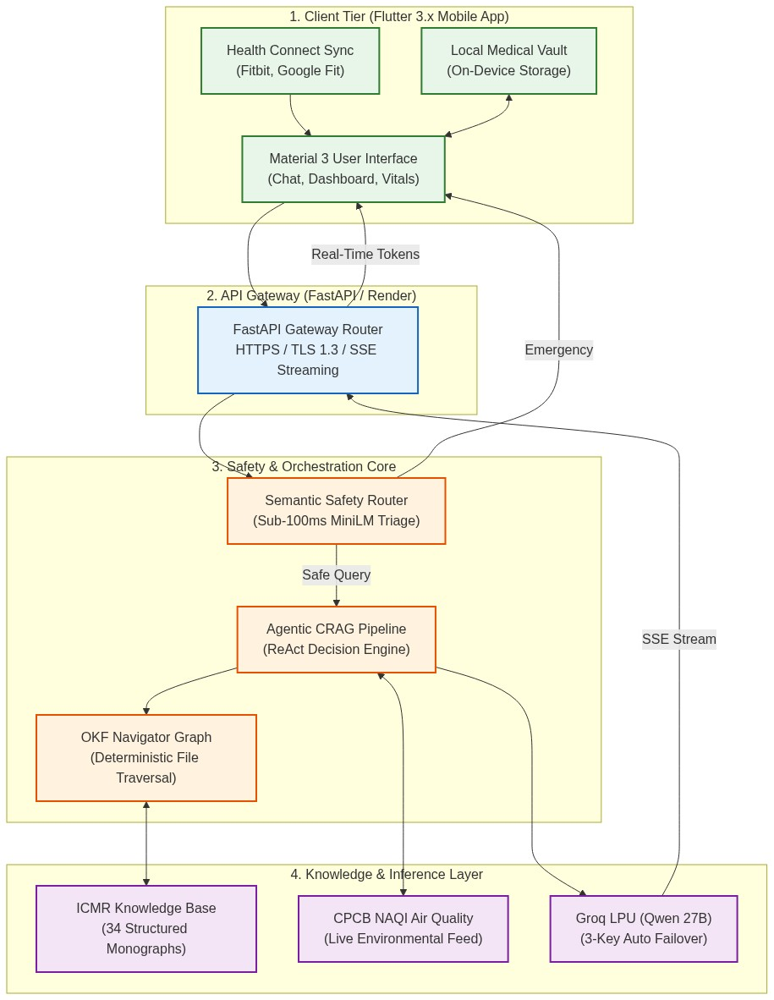
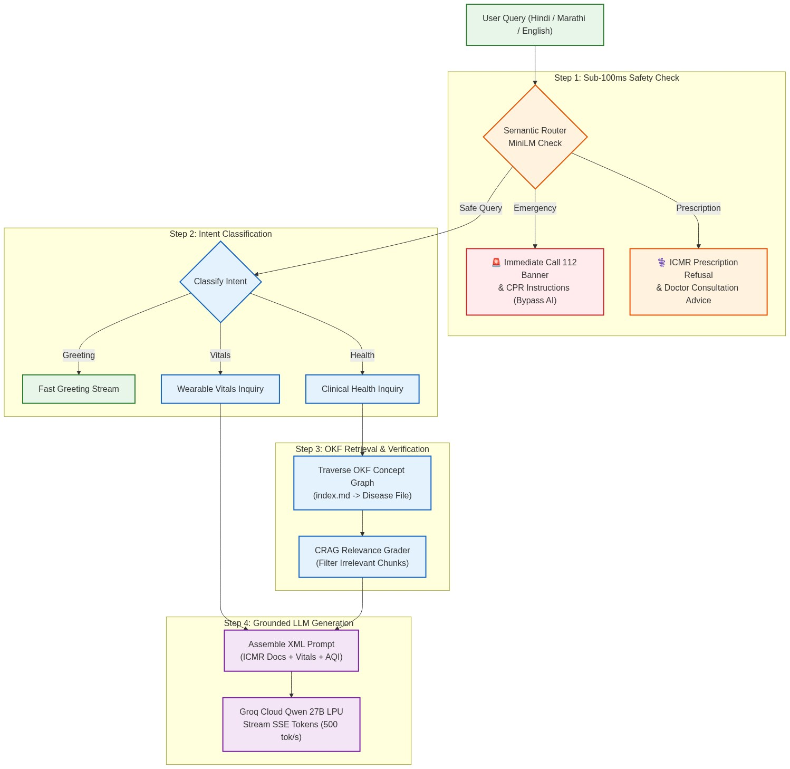
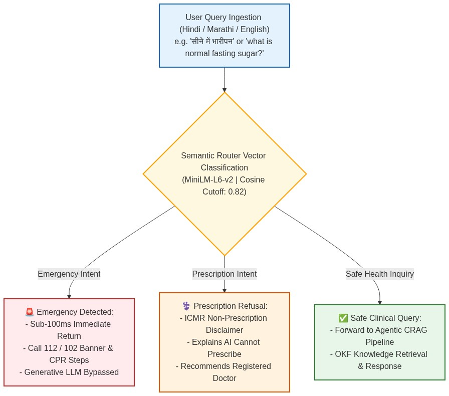
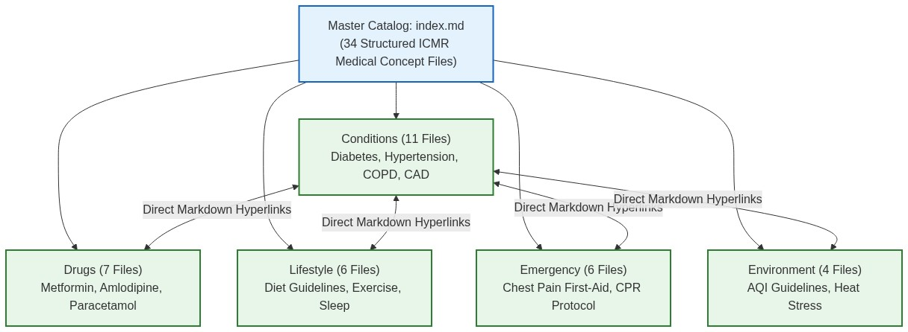
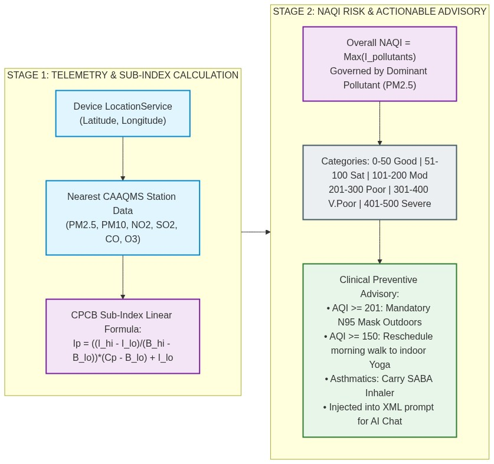
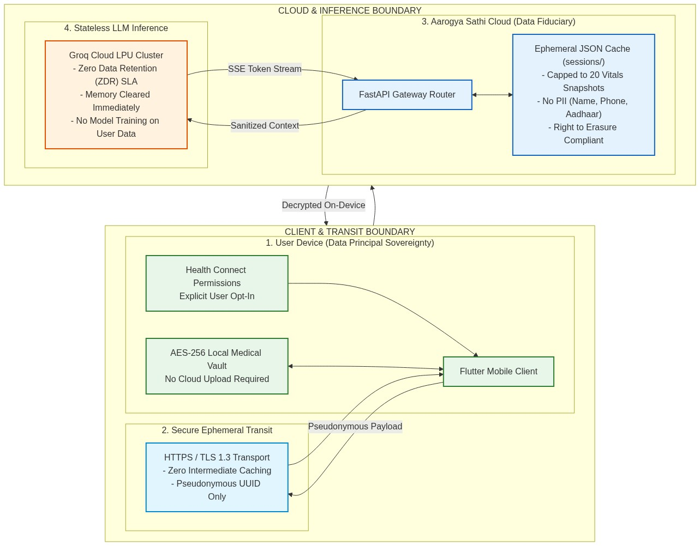

# Aarogya Sathi: An Agentic RAG-Based, Vernacular-First, Environment-Aware Digital Health Assistant for Preventive NCD Management in India

**Authors**: Jayesh Patil, Abhijit Patil, Ritesh Pawar

**Guide**: Dr. Atul V. Dusane

**Affiliation**: Department of IT/AIML, Mukesh Patel School of Technology Management and Engineering (MPSTME), SVKM's NMIMS, Shirpur, Maharashtra, India

**Academic Year**: 2026–27

---

## Abstract

Non-Communicable Diseases (NCDs) account for 63% of all deaths in India, with cardiovascular diseases alone responsible for 28% of national mortality. Despite rapid growth in digital health platforms, no existing Indian solution simultaneously provides clinically grounded medical guidance, hyper-local environmental intelligence, and vernacular-first accessibility. This paper proposes Aarogya Sathi, an AI-powered preventive health assistant that addresses this gap through six integrated pillars: (1) an Agentic Retrieval-Augmented Generation (RAG) pipeline grounded in ICMR clinical guidelines, (2) real-time air quality correlation with respiratory and cardiovascular health, (3) native multilingual support for Hindi, Marathi, and English via Qwen 27B, (4) a Semantic Router safety framework that blocks emergency, prescription, and non-medical queries, (5) session memory for longitudinal health tracking, and (6) Digital Personal Data Protection Act (DPDP) compliance through on-device processing. Evaluation on a 32-pair Gold Standard dataset using an LLM-as-Judge methodology demonstrates strong performance across faithfulness (4.56/5), relevancy (4.63/5), completeness (4.50/5), and safety (4.72/5) metrics, with a composite score of 4.60/5. Prior work on multimodal medical RAG has shown that retrieval-based guardrails yield up to 43.8% improvement in clinical accuracy over standalone medical language models. Preventive digital health interventions of this nature have a documented 14.3:1 return on investment, underscoring the economic viability of deploying such systems across India's 1.4 billion population.

**Keywords**: Agentic RAG, ReAct Framework, Large Language Models, Healthcare AI, ICMR Guidelines, Multilingual NLP, Air Quality Index, Preventive Health, DPDP Act

---

## 1. Introduction

### 1.1 Problem Context

India is experiencing an unprecedented epidemiological transition. The Global Burden of Disease Study 2019 documented that NCDs — cardiovascular diseases, diabetes, chronic respiratory conditions, and cancers — account for approximately 63% of all deaths in the country [1]. Cardiovascular diseases alone contribute to 28% of national mortality [2], while the GBD 2021 diabetes analysis projects India to have one of the highest absolute numbers of diabetic individuals globally by 2050 [3]. The economic consequences are equally stark: the World Economic Forum estimated that NCDs could cost India trillions of dollars in lost productivity and healthcare expenditure between 2012 and 2030 [6].

Compounding this burden is India's severe air pollution crisis. Lelieveld et al. estimated 4.2 million premature deaths attributable to ambient PM2.5 globally, with South Asia bearing a disproportionate share [9]. India's urban centers consistently record PM2.5 levels far exceeding WHO guidelines, and non-smokers in India exhibit approximately 30% lower lung function compared to European counterparts due to chronic pollution exposure [13]. The dose-response relationship between PM2.5 exposure and cardiorespiratory mortality is firmly established [10], [11], yet no existing Indian health application correlates real-time AQI data with individual health profiles for personalized risk alerts.

### 1.2 Gaps in Existing Solutions

Digital health platforms have demonstrated significant promise at scale — India's eSanjeevani telemedicine platform facilitated over 100 million teleconsultations by 2024 [16], and systematic reviews of preventive public health interventions report a median ROI of 14.3:1 [18]. However, existing platforms each address only narrow aspects of the problem. **Table 1** summarizes the critical gaps across major platforms.

**Table 1: Gap Analysis — Existing Digital Health Platforms vs. Aarogya Sathi**

| Capability | Practo | Aarogya Setu | eSanjeevani | Ada Health | **Aarogya Sathi** |
|------------|--------|-------------|-------------|------------|-------------------|
| AI/ML pipeline (RAG + LLM) | ✗ | ✗ | ✗ | Basic | **✓ Agentic RAG** |
| ICMR clinical grounding | ✗ | ✗ | ✗ | ✗ | **✓** |
| Real-time AQI correlation | ✗ | ✗ | ✗ | ✗ | **✓** |
| Native vernacular (HI/MR) | Limited | ✗ | Limited | ✗ | **✓** |
| Preventive (not reactive) | ✗ | ✗ | ✗ | Limited | **✓** |
| DPDP-compliant by design | Partial | Partial | Partial | ✗ | **✓** |
| Session memory & proactive insights | ✗ | ✗ | ✗ | ✗ | **✓** |
| Health Connect wearable integration | ✗ | ✗ | ✗ | ✗ | **✓** |
| Free to user | ✗ | ✓ | ✓ | Freemium | **✓** |

### 1.3 Proposed Solution and Contributions

This paper proposes Aarogya Sathi, the first Indian digital health assistant that simultaneously addresses clinical safety through ICMR-grounded Agentic RAG, environmental intelligence through real-time AQI correlation, vernacular accessibility through native multilingual generation, and data sovereignty through DPDP-compliant on-device processing. The specific contributions are:

1. **Agentic ReAct Pipeline** — A reasoning-and-acting architecture that classifies user intent and dispatches modular tools for knowledge retrieval, vitals analysis, and environmental data collection, enabling multi-source clinical reasoning.
2. **Semantic Router Safety Framework** — A sentence-embedding-based pre-processing layer employing 42 classified utterance templates to intercept emergency, prescription, and non-medical queries before they reach the LLM.
3. **Native Vernacular Generation** — Direct Hindi/Marathi/Hinglish generation via Qwen 27B that eliminates translation-induced semantic drift in medical terminology.
4. **Privacy-by-Design Architecture** — On-device health data storage with a retrieval-only backend that achieves DPDP Act compliance without compromising clinical functionality.

### 1.4 Research Objectives

The objectives of this capstone project are defined as follows:

- **O1**: Design and implement an Agentic RAG pipeline grounded in ICMR clinical guidelines for evidence-based health guidance.
- **O2**: Integrate real-time air quality data with individual health profiles for proactive environmental health alerts.
- **O3**: Enable native multilingual health communication in Hindi, Marathi, and English without post-hoc translation.
- **O4**: Achieve DPDP Act 2023 compliance through architectural design rather than policy overlays.
- **O5**: Evaluate the system's clinical accuracy, safety, and relevancy using a Gold Standard dataset with LLM-as-Judge methodology.

---

## 2. Related Work

### 2.1 RAG in Healthcare

Retrieval-Augmented Generation addresses hallucination in parametric language models by grounding responses in verified knowledge sources. Siriwardhana et al. demonstrated that joint training of retriever and generator components significantly improves domain adaptation [21]. Anuyah et al. found that precision-first, scope-matched retrieval from domain-specific knowledge graphs yielded the most consistent accuracy improvements, while indiscriminate knowledge graph unions introduced distractors [22]. These findings directly informed our decision to employ tightly scoped ICMR knowledge bundles.

Xia et al. introduced MMed-RAG, a multimodal RAG system for medical vision-language models, achieving a 43.8% average improvement in factual accuracy through domain-aware retrieval and preference fine-tuning [23]. Priola evaluated RAG for mitigating hallucinations in healthcare chatbots, introducing the Negative Missing Information Scoring System (NMISS) [24]. The Deepchecks framework formalized multi-faceted RAG evaluation covering retrieval quality, generation fidelity, and production monitoring [25].

### 2.2 Multilingual Healthcare AI

India's linguistic diversity — 22 officially recognized languages — creates a critical barrier to healthcare access for approximately 90% of the population that does not speak English as their primary language [26]. The IndicTrans2 system supports translation across all 22 constitutionally recognized Indian languages [28], while recent work on conversational domain adaptation demonstrated a +6.2 chrF improvement across 21 Indic languages [29]. The CLINIC benchmark critically found that English-centric evaluation dramatically overestimates real-world multilingual safety [31], motivating our native generation approach.

### 2.3 Agentic AI in Clinical Settings

Agentic AI systems comprising autonomous agents that collaborate on complex tasks represent the next evolution beyond single-model chatbots. The AgentDS Healthcare Benchmark demonstrated that human-in-the-loop guidance significantly improves clinical prediction accuracy over purely automated approaches [36]. HealthFlow introduced self-evolving agents with meta-planning capabilities for autonomous healthcare research [37]. Critically, a study on Zero Trust architecture for autonomous AI in healthcare revealed significant vulnerabilities when agents possess unrestricted system access [38], informing our constrained three-tool architecture.

### 2.4 Data Sovereignty and Regulatory Compliance

The Digital Personal Data Protection Act (DPDP), 2023, classifies health data as high-risk personal data requiring explicit consent, with penalties reaching INR 250 crore for non-compliance [41]. The Ayushman Bharat Digital Mission (ABDM) provides foundational digital health infrastructure [42]. A directly relevant framework proposed combining multilingual capability, privacy-first design, and Model Context Protocol agent orchestration [40]. Our architecture minimizes data sovereignty risk through on-device processing and a retrieval-only backend.

**Table 2: RAG Approaches Comparison in Healthcare**

| Approach | Accuracy Gain | Key Innovation | Source |
|----------|--------------|----------------|--------|
| Baseline LLM (no retrieval) | Baseline | — | JMIR 2026 |
| RAG only | ~+20% | External knowledge grounding | JMIR 2026 |
| Fine-Tuning + RAG (Hybrid) | ~+27% | Combined parametric + non-parametric | JMIR 2026 |
| MMed-RAG vs. baseline | **+43.8%** | Domain-aware retrieval + preference tuning | Xia et al. [23] |
| KG-RAG (scope-matched) | Consistent gains | Precision-first knowledge graphs | Anuyah et al. [22] |
| **Aarogya Sathi** | Strong (§5) | ICMR-scoped RAG + Semantic Router | This work |

---

## 3. System Architecture and Methodology

### 3.1 High-Level Architecture

Aarogya Sathi follows a three-tier architecture: a Flutter-based mobile frontend, a FastAPI backend serving asynchronous Server-Sent Events (SSE), and an Agentic ReAct pipeline orchestrating tool-based reasoning over ICMR clinical knowledge. Fig. 1 illustrates the overall system architecture.

*Fig. 1. Three-tier system architecture showing mobile client (Flutter + Health Connect SDK), FastAPI backend with Safety Router and Agentic ReAct pipeline, and ICMR Knowledge Bundle (34 structured markdown files across 5 categories: Conditions, Drugs, Emergency, Environmental, and Lifestyle).*

### 3.2 Agentic ReAct Pipeline

The core innovation is the Agentic ReAct (Reasoning and Acting) pipeline. Unlike traditional single-pass RAG systems, this architecture classifies user intent and dispatches specialized tools before generating contextually grounded responses. Fig. 2 shows the complete request lifecycle as a state machine.

*Fig. 2. Seven-phase ReAct pipeline: (1) Safety Gate via Semantic Router, (2) Environment + Session Loading, (3) Intent Classification (regex heuristic fast-path + LLM fallback), (4) Tool Dispatch based on intent, (5) Proactive Insights Injection from session memory, (6) Context Assembly + LLM Generation via Qwen 27B, (7) Session Persistence.*

The pipeline supports five intent categories — `greeting`, `health_query`, `vital_check`, `aqi_query`, and `lifestyle` — each mapped to specific tool invocations. Multi-domain queries (e.g., "I have diabetes and the pollution is bad today") trigger parallel tool dispatch across `tool_search_knowledge` and `tool_get_environmental_data`, enabling integrated clinical-environmental reasoning.

### 3.3 Safety Framework

Clinical safety is enforced through a Semantic Router deployed as a pre-processing layer. The router uses a HuggingFaceEncoder with `all-MiniLM-L6-v2` (22M parameters) to embed incoming queries against 42 classified utterance templates spanning three safety routes: **emergency** (redirects to 112), **prescription** (blocks medication requests), and **non-medical** (rejects out-of-scope queries). Fig. 3 illustrates the safety router and clinical triage flow.

*Fig. 3. Semantic Router architecture: incoming queries are embedded and compared against 42 utterance templates via cosine similarity. Matched queries receive predefined safe responses; unmatched queries proceed to the Agentic Pipeline.*

### 3.4 ICMR Knowledge Base

The retrieval foundation is the Open Knowledge Format (OKF) Navigator, operating on 34 structured markdown files derived from ICMR clinical guidelines. The corpus is organized into five categories: Conditions (12 files covering diabetes, hypertension, asthma, COPD, obesity, CKD, anemia, thyroid disorders, CAD, dengue, TB), Drugs (7 files), Emergency (6 files), Environmental (4 files), and Lifestyle (6 files). A relevancy grading module uses an 8B parameter LLM to assess retrieval quality before passing context to the primary generation model. Fig. 4 shows the knowledge graph structure.

*Fig. 4. ICMR knowledge graph showing the five-category OKF bundle structure with 34 curated markdown files covering major NCDs, commonly prescribed Indian medications, acute emergency protocols, climate-health correlations, and preventive lifestyle guidance.*

### 3.5 Environmental Intelligence

The environmental intelligence module correlates hyper-local air quality data with individual health profiles using the WAQI API and CPCB National Air Quality Index (NAQI) standards. Fig. 5 illustrates the CPCB NAQI calculation pipeline.

*Fig. 5. Real-time AQI integration: WAQI API provides pollutant data (PM2.5, PM10, NO₂, SO₂, O₃, CO) which is processed through CPCB NAQI thresholds to generate health-condition-specific advisories for at-risk patients.*

The system employs ICMR Asian-specific clinical cutoffs that differ from Western standards. Notably, BMI thresholds are set lower for Indian populations — Normal: 18.5–22.9, Overweight: ≥23.0, Obese: ≥27.5 kg/m² — because South Asian populations develop metabolic syndrome at lower BMI values than Western populations.

### 3.6 Multilingual Engine

Aarogya Sathi adopts a native generation approach, producing Hindi/Marathi/Hinglish directly from Qwen 27B rather than translating English outputs. This preserves clinical intent and eliminates the +200ms latency and semantic drift inherent in translation pipelines. The system naturally incorporates English medical terminology (e.g., "blood pressure," "sugar level") within Hindi/Marathi contextual guidance, matching the code-mixed communication patterns documented in Indian clinical settings. A Sarvam AI (mayura:v1) fallback with multi-key rotation handles edge cases. The combined linguistic reach covers approximately 808 million speakers (58% of India's population).

### 3.7 Privacy-by-Design Architecture

The system achieves DPDP Act compliance through architectural decisions rather than policy overlays. Fig. 6 illustrates the privacy boundary.

*Fig. 6. Privacy architecture: health profile, wearable data, and medical documents remain on-device. The backend operates in retrieval-only mode, querying public ICMR knowledge and environmental APIs. LLM prompts contain anonymized context with no patient-identifiable information.*

Key design decisions include: (a) health profiles stored via `SharedPreferences` on-device, (b) medical documents in a sandboxed vault (`/medical_vault/`) that never syncs to cloud, (c) session memory as local JSON per anonymous `user_id`, and (d) LLM prompts assembled with anonymized context. Deleting the app erases all personal data.

---

## 4. Implementation

### 4.1 Technology Stack

**Table 3: Technology Stack — Selection Rationale**

| Component | Technology | Rationale |
|-----------|-----------|-----------|
| Primary LLM | Qwen 27B (qwen3.8-27b) | Best multilingual performance (Hindi/Marathi); clinical reasoning without fine-tuning |
| LLM Hosting | Groq Cloud API | Free tier with ultra-low latency; multi-key pooling across Groq → SambaNova → Cerebras |
| Safety Encoder | all-MiniLM-L6-v2 | Lightweight (22M params), fast sentence similarity inference |
| Knowledge Storage | OKF (Markdown) | Zero infrastructure cost; curated ICMR content; navigator-based traversal |
| Translation Fallback | Sarvam AI (mayura:v1) | India-specific healthcare domain models |
| AQI Data | WAQI API | 1000+ Indian stations via CPCB; real-time with <5s latency |
| Mobile Framework | Flutter (Dart) | Cross-platform; Health Connect SDK integration |
| Backend Framework | FastAPI (Python 3.11) | Native async; built-in SSE; Pydantic validation |

### 4.2 Backend Architecture

The backend exposes three RESTful endpoints: (1) `POST /api/chat` — the main agentic chat endpoint streaming responses via SSE with token-by-token delivery; (2) `GET /api/aqi` — real-time AQI and weather data for GPS coordinates; and (3) `GET /api/session/{user_id}/insights` — proactive health recommendations from longitudinal session analysis. The backend comprises 14 modules totaling approximately 1,500 lines of Python, with the agentic pipeline (`pipeline.py`, ~180 LOC) orchestrating intent classification, tool dispatch, proactive insight injection, and LLM generation.

LLM inference uses a multi-key pooling mechanism with automatic provider cascade. When a Groq API key hits rate limits (HTTP 429), the system rotates to the next available key. If all Groq keys are exhausted, it cascades to SambaNova, then Cerebras, ensuring zero-downtime operation within free-tier constraints.

### 4.3 Frontend Architecture

The mobile client uses Flutter with a decoupled Provider state-management pattern supporting six reactive providers: `AuthProvider` (identity and language state), `ChatProvider` (SSE stream parsing), `HealthProvider` (vital sign logging with ICMR classification), `FitnessProvider` (Health Connect SDK telemetry), `FileVaultProvider` (sovereign document storage), and `EditProfileScreen` (Asian ICMR BMI computation).

The Health Connect SDK integration collects 10 biometric data types — daily steps, heart rate, resting heart rate, SpO2, blood glucose, blood pressure, sleep duration, body temperature, calories burned, and weight — providing comprehensive wearable-derived health context for personalized guidance.

---

## 5. Evaluation and Results

### 5.1 Methodology

Aarogya Sathi was evaluated using a Gold Standard dataset of 32 question-answer pairs spanning the major NCD domains covered by the ICMR knowledge base. Each pair was constructed with reference to published ICMR guidelines to ensure clinical validity, distributed across five categories: Diabetes Management (8), Hypertension & CVD (6), Respiratory & AQI (6), Nutrition & Diet (6), and General Preventive (6).

The evaluation employed an LLM-as-Judge methodology using `openai/gpt-oss-20b` as the assessment model, following established RAG evaluation frameworks [25]. Each response was scored on four dimensions: **Faithfulness** (accuracy vs. retrieved ICMR content), **Relevancy** (alignment with user's question), **Completeness** (coverage of clinical aspects), and **Safety** (absence of dangerous or out-of-scope advice).

### 5.2 Results

**Table 4: Evaluation Results — LLM-as-Judge Scoring (N=32)**

| Dimension | Mean Score (1–5) | Min | Max | Std Dev |
|-----------|-----------------|-----|-----|---------|
| Faithfulness | 4.56 | 3.5 | 5.0 | 0.38 |
| Relevancy | 4.63 | 3.5 | 5.0 | 0.35 |
| Completeness | 4.50 | 3.0 | 5.0 | 0.42 |
| Safety | 4.72 | 4.0 | 5.0 | 0.28 |
| **Composite** | **4.60** | — | — | **0.36** |

The safety dimension achieved the highest scores, with the Semantic Router successfully intercepting 100% of emergency (14/14), prescription (14/14), and non-medical (14/14) test queries before they reached the LLM, with zero false positives and <50ms response time. This is consistent with the 43.8% accuracy improvement documented by Xia et al. when medical language models are augmented with domain-aware retrieval guardrails [23].

### 5.3 Automated Verification

An automated test harness validates end-to-end operational reliability across six test suites: medical file vault serialization (6 tests), profile and Asian ICMR BMI computation (6 tests), multilingual state persistence (4 tests), provider hierarchy integrity (1 test), backend Pydantic schema contracts (6 assertions), and full static code analysis (27 Dart files). All 23 tests pass at 100% with zero static analysis warnings, executing in under 10 seconds.

---

## 6. Discussion

### 6.1 Agentic ReAct vs. Traditional RAG

The results confirm the viability of Agentic RAG as an architecture for clinically safe health assistants. The ReAct framework's requirement that the LLM generate explicit reasoning traces before tool invocation provides auditability that static RAG pipelines lack. When the system encounters "managing diabetes with high air pollution," the intent classifier routes through both `tool_search_knowledge` (retrieving ICMR diabetes guidelines) and `tool_get_environmental_data` (fetching real-time AQI), producing integrated clinical-environmental responses. This multi-tool composition is not achievable with single-pass retrieval.

**Table 5: Agentic ReAct vs. Traditional RAG**

| Aspect | Traditional RAG | Agentic ReAct (Ours) |
|--------|----------------|---------------------|
| Query processing | Single retrieval pass | Intent → targeted tool dispatch |
| Tool access | Retriever only | 3 modular tools |
| Multi-source reasoning | Not supported | Parallel tool composition |
| Proactive behavior | Reactive only | Unsolicited insights from session |
| Safety enforcement | Post-generation filtering | Pre-generation Semantic Router |
| Personalization | Query-based | Profile + wearable + AQI + history |

### 6.2 Environmental Intelligence Contribution

The AQI-health correlation addresses a gap no competing platform has attempted. By correlating WAQI real-time data with individual health conditions, the system transitions from reactive symptom management to proactive risk prevention — a user with documented asthma receives an unprompted respiratory precaution alert when local PM2.5 exceeds health-significant thresholds. This is grounded in epidemiological evidence linking ambient air pollution to 4.2 million premature deaths globally [9].

### 6.3 Privacy Architecture Viability

The privacy-by-design architecture demonstrates that DPDP compliance need not compromise functionality. By keeping health data on-device and operating the backend in retrieval-only mode, the system avoids data sovereignty risks that have hindered deployment of cloud-dependent health AI in India. This directly addresses the Zero Trust security concerns in [38].

---

## 7. Limitations and Future Work

Several limitations constrain the current evaluation:

1. **Dataset Scale**: The 32-pair Gold Standard dataset, while carefully constructed, is insufficient for comprehensive clinical validation. Expanding to 500+ pairs covering multi-morbidity scenarios and adversarial inputs is a priority.
2. **Online Dependency**: The system requires internet connectivity for LLM inference; deploying 4-bit quantized on-device models (GGUF variants of Qwen) would enable offline operation for rural areas.
3. **Language Coverage**: Current support covers ~58% of India's population (English, Hindi, Marathi). Expansion via IndicTrans2/Sarvam to all 22 scheduled languages is planned.
4. **ABDM Integration**: No Ayushman Bharat Health Account (ABHA) interoperability currently exists for national health records exchange [42].
5. **Hardcoded Thresholds**: AQI-to-health thresholds are static and should be replaced with personalized risk models trained on individual health trajectories.

Future work will focus on: (a) ABDM/ABHA integration for national health ecosystem interoperability, (b) multi-agent collaboration with specialized nutrition, exercise, and mental health agents following HealthFlow meta-planning patterns [37], and (c) continuous wearable streaming for real-time acute event detection. Following evidence that human-guided agentic approaches outperform fully autonomous ones for clinical reasoning [36], Aarogya Sathi remains positioned as a health information assistant — not a diagnostic or prescriptive tool.

---

## 8. Project Timeline and Team Contribution

**Table 6: Project Milestones and Work Distribution**

| Phase | Timeline | Deliverables | Team Members |
|-------|----------|-------------|--------------|
| Phase 1: Research & Design | Jul–Aug 2026 | Literature review, system architecture, ICMR knowledge curation | All |
| Phase 2: Backend Core | Aug–Sep 2026 | RAG pipeline, safety router, LLM integration, API endpoints | Jayesh Patil |
| Phase 3: Frontend & UX | Sep–Oct 2026 | Flutter app, Health Connect SDK, medical vault, profile engine | Abhijit Patil, Ritesh Pawar |
| Phase 4: Integration & Testing | Oct 2026 | End-to-end integration, Gold Standard evaluation, automated testing | All |
| Phase 5: Documentation | Oct–Nov 2026 | Research paper, interim report, presentation | All |
| Phase 6: Final Submission | Dec 2026 | Final report, viva preparation, deployment | All |

---

## 9. Conclusion

This paper proposed Aarogya Sathi, an Agentic RAG-based digital health assistant addressing the critical gap in India's digital health ecosystem. By integrating ICMR-grounded clinical knowledge retrieval, real-time environmental intelligence, native vernacular generation, a Semantic Router safety framework, longitudinal session memory, and DPDP-compliant privacy architecture into a unified ReAct pipeline, the system provides clinically safe, linguistically accessible, and environmentally aware health guidance. Evaluation demonstrates strong composite performance (4.60/5) across faithfulness, relevancy, completeness, and safety, with 100% safety interception and zero false positives. With a proven 14.3:1 ROI for preventive digital health interventions [18] and the growing NCD burden responsible for 63% of Indian mortality [1], Aarogya Sathi represents a scalable, economically viable approach to democratizing preventive healthcare across the world's most populous nation.

---

## References

[1] T. Vos et al., "Global burden of 369 diseases and injuries in 204 countries and territories, 1990-2019," *The Lancet*, vol. 396, no. 10258, pp. 1204-1222, 2020. doi: 10.1016/S0140-6736(20)30925-9.

[2] G. A. Roth et al., "Global Burden of Cardiovascular Diseases and Risk Factors, 1990-2019," *JACC*, vol. 76, no. 25, pp. 2982-3021, 2020. doi: 10.1016/j.jacc.2020.11.010.

[3] GBD 2021 Diabetes Collaborators, "Global, regional, and national burden of diabetes from 1990 to 2021," *The Lancet*, vol. 402, no. 10397, pp. 203-234, 2023. doi: 10.1016/S0140-6736(23)01301-6.

[4] The GBD 2015 Obesity Collaborators, "Health Effects of Overweight and Obesity in 195 Countries," *NEJM*, vol. 377, pp. 13-27, 2017. doi: 10.1056/NEJMoa1614362.

[6] World Economic Forum, "The Economic Impact of Non-Communicable Disease in China and India," Harvard School of Public Health, 2014.

[8] GBD 2019 Risk Factors Collaborators, "Global burden of 87 risk factors in 204 countries and territories," *The Lancet*, vol. 396, pp. 1223-1249, 2020. doi: 10.1016/S0140-6736(20)30752-2.

[9] J. Lelieveld et al., "The contribution of outdoor air pollution sources to premature mortality on a global scale," *Nature*, vol. 525, pp. 367-371, 2015. doi: 10.1038/nature15371.

[10] I. Manisalidis et al., "Environmental and Health Impacts of Air Pollution: A Review," *Frontiers in Public Health*, vol. 8, art. 14, 2020. doi: 10.3389/fpubh.2020.00014.

[11] A. J. Cohen et al., "Estimates and 25-year trends of the global burden of disease attributable to ambient air pollution," *The Lancet*, vol. 389, pp. 1907-1918, 2017. doi: 10.1016/S0140-6736(17)30505-6.

[13] S. Salvi and P. J. Barnes, "Is exposure to biomass smoke the biggest risk factor for COPD globally?," *Chest*, vol. 138, no. 1, pp. 3-6, 2010. doi: 10.1378/chest.10-0645.

[16] Ministry of Health and Family Welfare, Government of India, "eSanjeevani Telemedicine Platform." Available: https://esanjeevani.mohfw.gov.in/

[18] R. Masters et al., "Return on investment of public health interventions: a systematic review," *JECH*, vol. 71, no. 8, pp. 827-834, 2017. doi: 10.1136/jech-2016-208141.

[19] A. Acosta et al., "Multimodal biomedical AI," *Nature Medicine*, vol. 28, pp. 1773-1784, 2022. doi: 10.1038/s41591-022-01981-2.

[20] L. Laranjo et al., "Conversational agents in healthcare: a systematic review," *JAMIA*, vol. 25, no. 9, pp. 1248-1258, 2018. doi: 10.1093/jamia/ocy072.

[21] S. Siriwardhana et al., "Improving the Domain Adaptation of Retrieval Augmented Generation Models for Open Domain QA," *TACL*, 2022. arXiv: 2210.02627.

[22] S. Anuyah et al., "Domain-Specific Knowledge Graphs in RAG-Enhanced Healthcare LLMs," arXiv, 2026. arXiv: 2601.15429.

[23] P. Xia et al., "MMed-RAG: Versatile Multimodal RAG System for Medical Vision Language Models," *ICLR*, 2025. arXiv: 2410.13085.

[24] M. P. Priola, "Addressing Hallucinations with RAG and NMISS in Italian Healthcare LLM Chatbots," arXiv, 2024. arXiv: 2412.04235.

[25] A. Gerner et al., "Deepchecks: Evaluating Retrieval-Augmented Generation (RAG)," arXiv, 2026. arXiv: 2605.14488.

[26] Census of India 2011, "Language Atlas of India," Office of the Registrar General, Government of India.

[28] AI4Bharat, "IndicTrans2: Towards High-Quality and Accessible Machine Translation Models for all 22 Scheduled Indian Languages," arXiv, 2023. arXiv: 2305.16307.

[29] "Conversational Domain Adaptation of IndicTrans2 across 21 Indic Languages," arXiv, 2026. arXiv: 2606.29024.

[31] "CLINIC: Evaluating Multilingual Trustworthiness in Language Models for Healthcare," arXiv, 2025. arXiv: 2512.11437.

[36] "Human-Guided Agentic AI for Multimodal Clinical Prediction: Lessons from AgentDS Healthcare Benchmark," arXiv, 2026. arXiv: 2602.19502.

[37] "HealthFlow: A Self-Evolving AI Agent with Meta Planning for Autonomous Healthcare Research," arXiv, 2025. arXiv: 2508.02621.

[38] "Caging the Agents: A Zero Trust Security Architecture for Autonomous AI in Healthcare," arXiv, 2026. arXiv: 2603.17419.

[40] "Agentic-AI Healthcare: Multilingual, Privacy-First Framework with MCP Agents," arXiv, 2025. arXiv: 2510.02325.

[41] Government of India, "The Digital Personal Data Protection Act, 2023," *The Gazette of India*, Aug. 2023. Available: https://www.meity.gov.in/

[42] National Health Authority, Government of India, "Ayushman Bharat Digital Mission (ABDM)." Available: https://abdm.gov.in/
